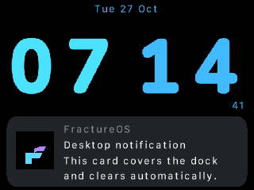
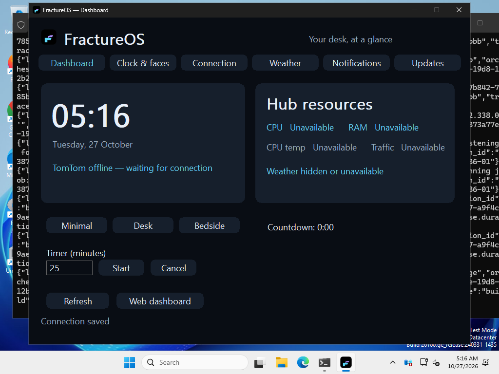
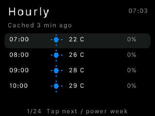
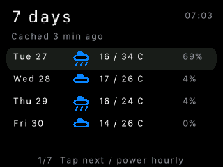

# FractureOS v3

A quiet, customizable clock for a TomTom ONE (v6), with a C device app and Go Linux hub / Windows tray companion. **v0.1.10 is built and its preview was checked on the TomTom. Final device activation and volume-icon replacement are pending reconnection, at the owner’s request.** It uses the existing OpenTom kernel and drivers; installation replaces the application startup, not the bootloader or firmware.

The original nine faces are now editable FractureOS assets. The blue Nunito face restores its original proportions with a centered date and live seconds, optional larger stacked digits, optional horizontal **HH : MM**, a blinking colon, and an hour-only behavior: **10:00 shows 10 throughout that minute; 10:01 returns to the full time** in either layout. The clock geometry adapts to a compact bottom dock; date and seconds are drawn at their final text size instead of shrinking a completed image. Digits have a configurable 0–2 pixel weight (default 1). The old information sidebar and its application dependencies are absent from the new renderer. Only the selected face's 170 KB digit atlas is resident.



The interface uses pure-black backgrounds, rounded menu highlights, simple metric/timer symbols and brief 180 ms selection transitions. The owner’s SF Compact font is used locally on their TomTom; public packages include an open Nunito text atlas.

## Install

On the **Linux machine connected to the TomTom** (Ubuntu and other Linux distributions, x86-64 or ARM64):

```sh
curl -fsSL https://raw.githubusercontent.com/sepisotoni/FractureOS-v3/v0.1.10/install/install.sh | sh
```

Then, with the TomTom reachable over its USB network:

```sh
~/.local/bin/fracture device install
~/.local/bin/fracture settings
```

The installer selects the host architecture, verifies the release SHA-256, installs under `~/.local`, and starts a user systemd hub when available. Otherwise it prints the `fracture serve` command. Device deployment is explicit because the TomTom must be plugged in; it includes the legacy ARM binary and works around the missing device applets. Python 3 is required on the Linux host for deployment. No compiler is required for installation.

On **64-bit Windows**, paste into PowerShell:

```powershell
irm https://raw.githubusercontent.com/sepisotoni/FractureOS-v3/v0.1.10/install/install.ps1 | iex
```

An **Inno Setup `.exe` installer** installs the native dashboard, tray and uninstaller for the current user. Connection and clock configuration live in app Settings. x64 installation, native window/tab navigation, settings persistence, closing and uninstallation were exercised on a Windows runner. ARM64 is cross-built; real Spotify/PawnIO hardware acceptance is still pending. macOS, 32-bit PCs and direct installation from a shell on the TomTom are unsupported.

Release archives and checksums: [v0.1.10 downloads](https://github.com/sepisotoni/FractureOS-v3/releases/tag/v0.1.10). You can download and inspect the installer before running it. Checksums verify download integrity; signed release manifests are still on the roadmap.

## Connect Windows to the hub

The hub binds to localhost by default. On the Linux hub, for this setup:

```sh
fracture config set listen 192.168.101.105:47831
systemctl --user restart fracture-v3.service
fracture pair-info
```

In Windows **Settings → Hub connection**, enter `https://192.168.101.105:47831` plus the fingerprint and token displayed by `pair-info`. Keep the token private. The hub uses pinned TLS and a bearer token; the device remains at `192.168.101.115` over the trusted USB connection. Restart the hub after changing its listen address, device address or token.

For remote access use a private network/VPN to the Linux hub; no public relay or automatic tunnel setup is included. The TomTom itself has no verified Wi-Fi. It works offline as a bedside clock while powered; network features at a different location require a USB-capable host there. The legacy root Telnet transport is for the trusted device link, not an Internet-facing interface.

## New in v0.1.10

- Timers, stopwatch and alarm share one measured bottom strip. The four telemetry readings keep their two-by-two layout and move into a narrower left panel when media/weather needs the right side.
- Notifications cover that area with a rounded gray card and optional artwork. Default display time is **10 seconds**. Tap to dismiss. Set duration in Notifications on PC, or **Settings → Notification time** on the TomTom.
- Navigation menus return to the clock after **30 seconds** without input. Set **Settings → Menu timeout** (0 disables it), or use Clock & faces on Windows. Active player and lyrics views stay open until you leave them.
- The player uses the Spotify mark and transport/volume/more symbols, with the time at the top right. More → Lyrics opens synchronized or plain lyrics.
- Weather has stored hourly and seven-day views. A new FractureOS logo is used by the executable, tray, installer and web favicon. The deployer backs up and replaces the device’s `tomtom.ico` when final activation is allowed.
- **Updates → Update FractureOS** checks GitHub, downloads the matching package, verifies its checksum, and updates the app. Windows closes and reopens its dashboard/tray; settings survive. The web dashboard offers the same action for its local host. Device deployment remains a separate action on the USB hub.

The owner unplugged the TomTom while the final payload was staging. Activation had not begun. The preview already inspected on the device remains the last observed running build; final activation, final overlay refinements and the root icon replacement await reconnection. No further device access is attempted during that interval.

## Use and customize

The launcher has **Clock, Timer, Stopwatch, Alarm, Media, Weather and Settings**. Timer and Alarm offer presets and custom values. Stopwatch has start/pause/resume, a last-lap reading and reset. Tap anywhere to browse; double-tap or a short power press selects. In a number editor, tap adds, double-tap subtracts and power applies. No touchscreen coordinates are used.

Power gestures act **on release**: below 1.5s selects; 1.5–3s goes back one page; 3–4.5s returns to the clock; 4.5–7s cancels; 7s or longer requests suspend. The optional indicator is green → blue → purple, disappears in the cancel range, then shows “Release to sleep.” A double power press also returns home. Touch hold goes back one page. Settings → Power contains confirmation screens for suspend, restart and shutdown, with Cancel selected first. The owner physically verified the indicator and Back/Home; suspend/wake and reboot/shutdown have not been exercised here.

`fracture dashboard` or `fracture settings` opens a **separate native Windows dashboard** with Clock & faces, Connection, Weather and Notifications tabs. It uses Go, Win32 and GDI, with no Electron or WebView runtime. Closing it releases the whole dashboard process. `fracture web` opens the independent web dashboard; Linux `fracture settings` opens this web version. **Watch faces** selects a design, changes stacked/horizontal layout, blinking and hour-only behavior, and edits colors, digit rectangles, date placement, 12/24-hour format and atlas choice. Export/import face JSON is supported; a drag-and-drop widget editor is future work. The settings process exits after five idle minutes. The browser has its own resource usage.

```sh
fracture status
fracture face nunito
fracture face-set layout stacked       # or horizontal
fracture face-set hour_only 1           # 0 keeps HH:00 visible
fracture face-set weight 1              # 0 original / 1 or 2 pixels thicker
fracture face-set blink 1               # 0 keeps colon steady
fracture face-set hour_color 4be1fa
fracture face-set minute_color 43b9ff
fracture face-get
fracture theme-set accent ff9933       # edit UI palette
fracture theme-set face_colors 1       # optionally recolor the face too
fracture theme-save my-night-theme     # save and select a custom preset
fracture theme my-night-theme
fracture face-reset                     # restore this supplied design
fracture profile bedside                # minimal / desk / bedside
fracture offset 120                     # UTC+02:00; no automatic DST yet
fracture timer 1500
fracture alarm 7 30                     # silent VISUAL alarm only
fracture alarm off
fracture stopwatch toggle              # start / pause / resume
fracture stopwatch lap                 # last-lap reading
fracture stopwatch reset
fracture config set metrics_interface auto # or a named Linux interface
fracture config set hub_metrics true    # Linux hub, collected only in Desk mode
fracture feature telemetry 0            # stop displaying/collecting telemetry
fracture feature telemetry 1            # PC can re-enable the device feature
fracture feature weather 1              # 0 off / 1 unusual only / 2 always
fracture feature appearance 2           # 0 night / 1 day / 2 auto (07:00-19:00)
fracture config set weather_enabled true
```

Face files and artwork are in [`assets/faces`](assets/faces). See [face format and provenance](docs/FACES.md). User overrides live outside the versioned release and survive updates. Choose `midnight` for the iOS-inspired pure-black interface. Themes edit the launcher, fallback clock and information band. Each theme can optionally recolor imported faces; otherwise those faces keep their own palettes. Settings includes color pickers and save-as for named themes.

## Spotify on your Windows PC

Enable **Settings → Windows media → Share and control Spotify**, keep the tray running, and open the Spotify desktop app. No Spotify developer account, OAuth login or client ID is used. The Go worker reads Windows media sessions and posts bounded track/artwork updates through the authenticated HTTPS hub to the TomTom. It checks every two seconds only while the player or enabled status-bar widget is visible; disabling sharing stops the worker. This is a companion bridge, not a webhook supplied by Spotify.

On the TomTom, open **Media → Spotify** for track/artist, album thumbnail, progress, previous/play-pause/next and a volume editor. Volume changes require selecting Volume, adjusting, then applying; it controls the **Windows default audio output**, including other apps. Spotify must expose the requested controls through its Windows session. Missing capabilities stay unavailable. No browser scripting, private Spotify API, account credentials or PowerShell runtime is used.

**Windows runtime acceptance is pending**: x64/ARM64 builds exist, but playback/artwork and volume must be checked on a real Windows 10 1809+ machine. Linux hub → TomTom media/artwork transport and control queue were tested with explicitly labeled fixture data. Lyrics are now supplied through the hub; YouTube and playing audio through the TomTom speaker remain pending. Album art currently occupies an unobscured square beside the controls.

Desk mode shows CPU load, RAM usage, **CPU temperature instead of disk usage**, and one traffic reading: the larger of upload/download. Its thermometer and combined traffic icons are drawn in C. Linux temperature uses CPU-specific hwmon sensors, preferring package/Tdie. Unavailable/stale readings disappear. Four statistics occupy two rows; when media/weather is present, those rows narrow to the left and the other information appears on the right. Timer, stopwatch and alarm share one measured strip. The clock uses wide HH : MM when the dock needs more room. Notification cards temporarily cover the dock, rather than creating additional rows.

On-device **Settings → Faces / Themes** previews the supplied designs. Tap cycles, Power keeps, Back/Home cancels. Only one atlas is retained; switching has a transient allocation while the replacement loads. **Appearance** offers night, high-contrast day, or automatic 07:00–19:00 using the clock's configured offset. Bedside stays dark. The new **neon** face adapts the supplied dashboard reference using existing font assets, with a chain-link connection indicator and actual charging state. It never invents a battery percentage. Day colors are a shared readable palette; independently editable per-face day palettes remain future work.



### Weather

Weather runs on the Linux hub, never as an HTTP client on the TomTom. Enable it in either dashboard. Initial coordinates are Johannesburg (`-26.2041, 28.0473`); change them in Settings for another location. The installed owner's hub is enabled, with **unusual conditions only** on the TomTom. Public fresh installations leave the provider off.

Open-Meteo current conditions are fetched every 15 minutes while the clock is visible. A small cache prevents refetching when opening/closing menus. The worker exits when disabled, when the device is disconnected, or when weather has no visible clock consumer. Normal conditions stay hidden in unusual-only mode. Thunderstorms, heavy/freezing rain, heavy snow, temperatures at/above 35°C or at/below 0°C, and gusts at/above 60 km/h count as unusual; temperature/wind thresholds are editable. The alternative is **Always**. Stale/missing readings disappear. Weather occupies one small icon/text row; no weather bitmap pack is installed on the TomTom.

Open **Apps → Weather** for current cached conditions. Choose **Hourly** or **7 days**. Tap advances the selected entry and scrolls through four entries at a time; Power switches hourly/week views; hold Power 1.5 seconds to go back. The cache stores 24 hours and seven days, with temperature, weather symbols and available rain probability. Its age is shown, including offline. The device reads its tiny SD cache only while Weather is open, and releases the forecast array when leaving.

 

Data: [Open-Meteo](https://open-meteo.com/) under CC BY 4.0; [API documentation](https://open-meteo.com/en/docs). These are modeled current conditions, not an official emergency warning service. The free endpoint is intended for non-commercial use.

### Optional Windows CPU temperature (PawnIO)

In the native app's **Connection** tab: **Get sensor modules**, then **Check sensor**. If PawnIO is already installed and reports access denied, choose **Authorize sensor** and approve the Windows UAC prompt. Only the separate temperature helper is elevated; the dashboard stays at ordinary user permissions. If the driver is missing, the driver button opens the [official PawnIO site](https://pawnio.eu/); install its signed edition. The sensor-module button downloads the upstream signed 0.2.11 package with a pinned SHA-256 and extracts only IntelMSR and AMDFamily17. No driver is silently installed by FractureOS setup. Then enable **Use this PC's CPU temperature** and Save connection; keep the tray running.

The Go worker uses the documented device IO-control interface directly, so no monitoring application or DLL is needed. It supports Intel thermal registers and AMD Zen's temperature sensor on Windows x64, with the required shared PCI mutex for AMD. It starts only when enabled and the TomTom clock requests telemetry; disabling it unloads the process. The approved helper sends only bounded temperature samples to a temporary authenticated loopback receiver. It validates pinned signed module hashes before loading them, does not receive the hub token, releases hardware handles while idle and exits after its idle grace period or when sharing is disabled. Keep the tray running. A valid PC reading temporarily takes priority over the Linux temperature and is labeled **PC** on the clock. CPU load/RAM still describe the Linux hub. Windows ARM64 temperature, general Windows resource collection and real PawnIO hardware acceptance remain pending. An unavailable sensor stays hidden.

### Lyrics

Open **Media → player → More → Lyrics**. The hub uses the Windows bridge’s track metadata to request LRCLIB lyrics only while that page is visible. Synced lyrics follow playback; plain lyrics use tap for the next page and double-tap for the previous page. Lookup availability/timing varies by track. Previous/current/next lines alone travel to the TomTom; the full song stays on the hub. A bounded cache holds at most eight songs for seven days. Disable lookups in PC settings if desired.

A client can also supply lyrics through authenticated `POST /api/lyrics`:

```json
{"operation":"provide","title":"Exact current title","artist":"Exact current artist","lrc":"[00:00.00]Original preview line\n[00:10.00]Another preview line"}
```

Use `text` for plain lyrics. `operation: "clear-provided"` with the same title/artist removes the override; a track change removes it automatically. This needs the hub bearer token and pinned HTTPS. The Windows bridge supplies metadata/playback; lyric text comes from LRCLIB or the supplying client. No Spotify developer credentials are required.

### Notifications and feature switches

**Settings → Features** on the TomTom controls telemetry, weather, notifications and media; paired PC controls can re-enable them. The web/native dashboards configure the authenticated notification endpoint and excluded app names. Example from a paired PC:

```sh
fracture notify "My application" "Task finished" "Your export is ready"
```

Or send `{ "app": "My application", "title": "Task finished", "body": "Your export is ready" }` to `POST /api/notifications` over pinned HTTPS with the hub bearer token. App exclusions are exact, case-insensitive names. Messages are bounded, displayed for 10 seconds by default, and rate-limited to one every two seconds. Notifications accept optional `artwork` as base64 PNG/JPEG (maximum 256 KiB), resized by the hub to a 48×48 RGB565 thumbnail. An optional `seconds` value overrides the configured duration, up to 120 seconds. Notifications are silent. Automatic forwarding of Windows toast notifications is **not** included: Windows requires a packaged listener and explicit consent. Notification audio and its sound toggle remain pending.

### This host's network

Linux/hub: **192.168.101.105**. TomTom USB: **192.168.101.115**. TomTom LAN alias: **192.168.101.114**, forwarded to `.115` with proxy ARP and NAT. `.114` is no longer assigned to Linux's LAN interface. The host-specific forwarding service is separate from the portable installer; see [network configuration and recovery](docs/NETWORK.md).

## What works now

| Component | Available in v0.1.10 |
|---|---|
| TomTom | Direct framebuffer clock; nine reused faces plus neon; face/theme previews; weather summary; feature switches; editable layout/colors; stacked/horizontal/hour-only modes; switch-operated menu; minimal/desk/bedside; countdown, stopwatch and silent visual daily alarm; persisted settings |
| Linux | TLS hub, CLI, settings UI, optional CPU/RAM/temperature/network worker that starts only in Desk mode and exits when unused; time sync; weather worker; notification webhook; device deployment and restoration |
| Windows | Native tray, separate native dashboard/settings and web dashboard; Inno installer/uninstaller checked on Windows x64; optional PawnIO worker (hardware verification pending) |
| Installation | Prebuilt Linux x86-64/ARM64 and Windows x64/ARM64 archives; checksum verification; versioned device payloads; original startup/icon backup; recovery to OpenTom |

This is not all 23 planned modules. Real Windows media/PawnIO acceptance, automatic Windows toast capture, audio forwarding, mirroring/true monitor extension, calendar, automatic Windows notifications, Windows metrics/activity switching, arbitrary widget composition, GPS, signed automatic updates and a general module loader remain on the [task board](TASKS.md). Core clock/menu/timer code is currently one small binary; Linux metrics/weather and Windows media/temperature run in separate processes only when enabled and requested. Full dynamic unloading of every core feature is not implemented.

Alarms require the device to remain powered and running; no sound or suspend wakeup is implemented. Timers and stopwatch state do not survive restart. Time uses a configured UTC offset; RTC retention and automatic DST are not validated. Brightness settings are persisted; the PWM driver allows only one opener, and effective brightness writes need a dedicated measurement rather than a second concurrent probe.

## Update, restore, uninstall

Rerun the version-pinned host installer for a newer release, then `fracture device install` on Linux. The deployer verifies each uploaded file by reading it back, backs up boot/startup files privately on the host, and installs into a new device release directory. It never silently overwrites a different executable under the same version. Failed activation returns to the saved OpenTom startup. This is a manual application update system; power-loss-safe journals and signed automatic updates are future work.

```sh
fracture device restore    # restore and start the saved OpenTom environment
fracture uninstall         # remove Linux host files/service, keep settings/backups
```

On Windows use **Installed Apps → FractureOS → Uninstall**. Removing a host app does not uninstall the TomTom. Restore the device first if that is desired. Device rollback files and original face directories are preserved; no old project files or firmware images are published here.

## Build, test and development

- [Task board](TASKS.md) — completed deliverables and outstanding modules.
- [Release validation](docs/RELEASE-VALIDATION.md) — measured results and testing limits.
- [Platform diagnostics](docs/DEVICE-VALIDATION.md) — hardware, ABI and missing applets.
- [Current implementation](docs/IMPLEMENTATION.md) — release architecture and deviations from the design.
- [Product vision](docs/PRODUCT-VISION.md), [architecture design](docs/ARCHITECTURE.md), [module specifications](docs/MODULES.md) — long-term scope, not claims of completed features.

Host code uses only the Go standard library. Release builds use the verified toolchain recorded in [`docs/HOST-TOOLCHAIN.json`](docs/HOST-TOOLCHAIN.json), obtained from the [official Go downloads feed](https://go.dev/dl/?mode=json). Device builds require the compatible GCC 3.3.4/glibc 2.3.2 OpenTom SDK; modern ARM EABI binaries do not run on this device. Set `FRACTURE_SDK` to its directory. Toolchain provenance is recorded; the legacy SDK is not bundled.

```sh
sh tools/build-device.sh
go test ./host
python3 tools/package-release.py
```
