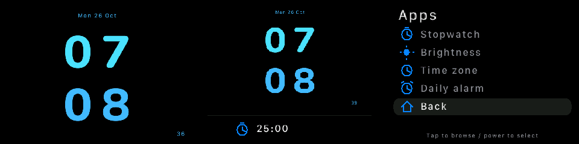
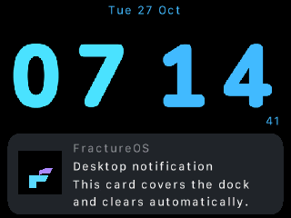
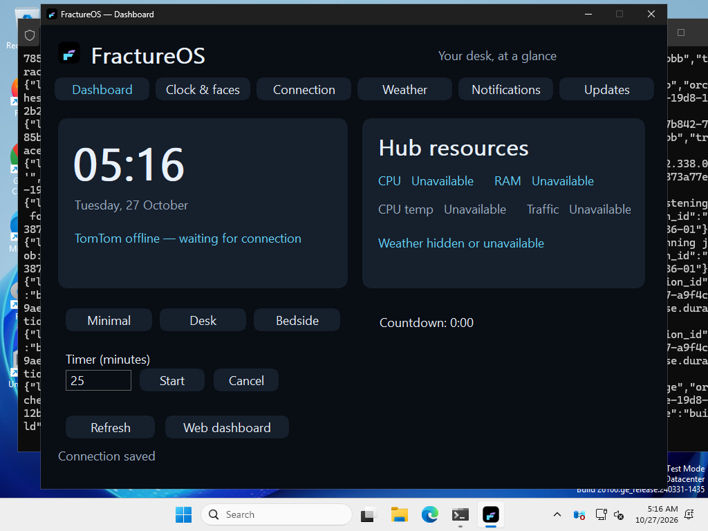
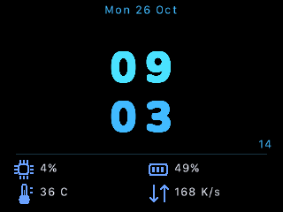
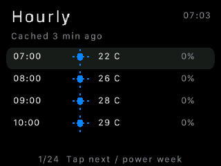
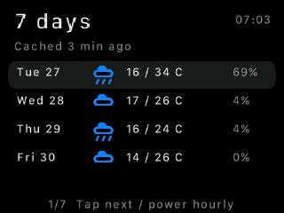

<div align="center">
  
  <h1>FractureOS v3 — Your quiet desk clock, powered by a TomTom ONE</h1>
  <p>
    <strong>Turns a classic TomTom ONE (v6) into a crisp, zero-bloat bedside &amp; desk companion — now with Direct USB PC hosting and a frosted glass dashboard.</strong>
  </p>
  <p>
    <a href="https://github.com/sepisotoni/FractureOS-v3/releases/tag/v0.1.18"></a>
    
    
    
  </p>
</div>

---

**FractureOS v3** replaces the navigation shell on a repurposed TomTom ONE v6 with a lightweight C framebuffer clock and pairs it with a tiny Go companion on Windows or Linux. It boots quickly onto pure-black OLED-style faces, draws only when needed, and stays out of your way with minimal memory and CPU overhead.

**Two ways to connect — zero extra hardware required.** Plug your TomTom directly into your Windows PC over USB (**Direct USB mode**), or attach it to a dedicated Linux host on your network and pair Windows over pinned HTTPS (**Remote Linux hub mode**). Switch anytime from System settings.

**Lightweight by design.** Background collectors for CPU/RAM, temperature, weather, Today agenda, lyrics, and audio capture use demand-driven lazy loading: workers only start while their widget or device page is actively visible, and unload cleanly when hidden or disabled.

<div align="center">
  &nbsp;&nbsp;
  
</div>

---

## Quick Install

### Windows (64-bit / ARM64)

Install using PowerShell (runs the verified Inno Setup `.exe` installer and creates a single **FractureOS** Start menu shortcut):

```powershell
irm https://raw.githubusercontent.com/sepisotoni/FractureOS-v3/v0.1.18/install/install.ps1 | iex
```

Or download `fracture-v0.1.18-windows-amd64-setup.exe` or the ARM64 equivalent and verify it against `SHA256SUMS`. [v0.1.18 prerelease](https://github.com/sepisotoni/FractureOS-v3/releases/tag/v0.1.18)

### Linux (Host / USB Hub — x86-64 / ARM64)

On the Linux machine connected to your TomTom:

```sh
curl -fsSL https://raw.githubusercontent.com/sepisotoni/FractureOS-v3/v0.1.18/install/install.sh | sh
```

Then deploy the C clock binary to the USB-connected TomTom (requires Python 3 on the Linux host) and open Settings:

```sh
~/.local/bin/fracture device install
~/.local/bin/fracture settings
```

> **Note:** FractureOS uses the existing OpenTom kernel/drivers and backs up original startup files before swapping startup. You can restore the stock TomTom environment anytime with `fracture device restore`.

---

## Choose Your Setup Mode

| Mode | Best For | How It Works |
|---|---|---|
| **Direct USB to this PC** | Single-PC desk setup on Windows | Runs the pinned TLS hub directly inside the Windows FractureOS tray app and talks straight to the TomTom at `192.168.101.115` over USB (with native Windows CPU/RAM + optional PawnIO temperature). |
| **Remote Linux hub** | Always-on hub (Raspberry Pi / Linux box) + Windows PC | Linux runs `fracture serve` over USB (`192.168.101.105:47831`); Windows connects over pinned HTTPS using your certificate fingerprint and bearer token from `fracture pair-info`. |

### Pairing Windows to a Linux Hub

On the Linux machine:

```sh
fracture config set listen 192.168.101.105:47831
systemctl --user restart fracture-v3.service
fracture pair-info
```

In Windows **FractureOS → Connection** (or web **System**): select **Remote Linux hub**, paste `https://192.168.101.105:47831`, the SHA-256 fingerprint, and bearer token, then save.

### v0.1.18.1 development candidate

- The native Windows app is built in Go using Win32 and GDI. Its clock renderer is a small C DLL shared with the TomTom. The setup program is built with Inno Setup.
- **Clock & faces** offers hour-only display at `:00` and menu timeout. Set a positive timeout to return to Home after inactivity. A value of `0` disables this, and the active player and lyrics pages stay open.
- **Appearance → Wallpaper** stages a preview before applying. In Direct USB, PC wallpaper follows the Windows desktop automatically. With a remote Linux hub, **Use this PC’s wallpaper** sends and saves a copy of the Windows desktop image.
- Web **Overview → View TomTom screen** captures the current display on request. The Windows Home preview renders locally. **Weather** can search for a city or town, or take coordinates directly.
- For intentional device updates, run `fracture device install` from the Linux host installation. The v0.1.18.1 Windows portable ZIP also includes the USB deployment files for `fracture.exe device install` with Python 3. Updating the Windows dashboard and updating the TomTom are separate steps.

---

## Features & Gallery

<div align="center">
  &nbsp;&nbsp;
  
</div>

- **10 Editable Clock Faces & Live 320×240 Preview**: Classic stacked and horizontal `HH : MM` layouts, `0–2 px` digit weight, blinking colon, hour-only `:00` display (`10:00` shows `10`), and custom color/layout presets (`Classic blue`, `Warm sunset`, `Cool aqua`, `Neon compact`). Only the active 170 KB atlas stays in device RAM.
- **Native Win32 & Frosted Glass Web Dashboards**: Manage everything from the ultra-low-footprint Win32/GDI app (`fracture dashboard`) with its local C renderer preview, or launch the glassmorphic web UI (`fracture web`) complete with live 320×240 Home Preview and instant Minimal / Desk / Bedside switching.
- **Desk Telemetry (Linux & Native Windows)**: CPU load, RAM usage, CPU temperature (Linux `hwmon` or optional Windows PawnIO helper), and peak upload/download rate. Collected **only** when Desk mode is visible.
- **Weather & Stored Forecasts**: Powered by [Open-Meteo](https://open-meteo.com/) (CC BY 4.0) via the host — never directly from the TomTom — with 24-hour hourly and 7-day offline caches on the device.
- **Today Agenda**: Opt-in read-only HTTPS `.ics` calendar summary fetched only while **Apps → Today** is open.
- **Windows Spotify Companion & Synced Lyrics**: Reads local Windows media sessions (no Spotify developer keys/OAuth needed) and streams rolling 12-line timestamped LRCLIB lyrics while the Lyrics page is open.
- **Low-Latency Audio Forwarding**: Opt-in 16 kHz mono PCM streaming from Windows WASAPI loopback or Linux PipeWire/PulseAudio to the TomTom speaker, with adjustable gain (5% default).
- **Silent Timers, Stopwatch, Visual Alarm & Webhooks**: Measured bottom dock strip, hardware power-button hold indicator, and `POST /api/notifications` with optional `48×48` artwork cards.

<div align="center">
  &nbsp;&nbsp;
  
</div>

---

## Everyday Device Controls

- **Home Screen**: Short **Power** press opens **Apps** (`Home`, `Clock`, `Media`, `Weather`, `Today`, `Settings`). Tap screen opens **Quick settings** (brightness, theme, battery/charging & hub link state).
- **Power Hold Gestures** *(acts on release)*: `< 1.5s` selects · `1.5–3s` goes back · `3–4.5s` returns Home · `4.5–7s` cancels · `7s+` requests suspend. Double Power press returns Home.

### Essential CLI Commands

```sh
fracture status                         # Inspect device state JSON
fracture profile desk                   # minimal | desk | bedside
fracture face neon                      # Switch active clock face
fracture face-set layout horizontal     # stacked | horizontal | custom
fracture face-set hour_only 1           # Show only hour digits at :00
fracture theme midnight                 # midnight | teal | amber | blue
fracture timer 1500                     # 25-minute countdown
fracture alarm 7 30                     # Silent visual alarm (or: alarm off)
fracture notify "Build" "Done" "Ready"  # Push notification card
fracture config set connection_mode direct
```

---

## What Changed in v0.1.17

- **Dual Connection Modes**: Run Windows connected straight to the TomTom over USB (`direct`) or routed through a remote Linux hub (`hub`).
- **Native Windows Telemetry & Subnet Audio Fix**: Built native Win32 CPU/RAM reporting (`GetSystemTimes` / `GlobalMemoryStatusEx`) and relaxed TomTom audio peer validation to `192.168.101.0/24`.
- **Dashboard Overhaul**: Reorganized the native Win32 dashboard into symmetric cards with zero clipping, redesigned the web dashboard with dark frosted glassmorphism and an interactive 320×240 Home Preview, and consolidated Windows Start Menu search results down to one **FractureOS** entry.
- **Bug & Leak Fixes**: Removed a duplicate Go 1.22+ `/api/audio` route registration panic, removed duplicate `audio-start` dispatch, and closed leaked framebuffer descriptors on error paths in C.

> **Historical note:** `v0.1.11` established the Inno Setup `.exe` installer and in-app updater workflow, which remains the standard Windows distribution path today. Hardware notes and limits for previous builds are documented in [Release Validation](docs/RELEASE-VALIDATION.md).

---

## Documentation, Building & Recovery

- [Codebase Architecture](docs/CODEBASE-ARCHITECTURE.md) — module map across C device code, Go host, and installers
- [Face Format & Provenance](docs/FACES.md) — editable `.face` schema, 170 KB `.pgm` atlases, and font licenses
- [Current Implementation](docs/IMPLEMENTATION.md) & [Task Board](TASKS.md) — implementation status and open gates
- [Network & Recovery](docs/NETWORK.md) & [Device Validation](docs/DEVICE-VALIDATION.md) — USB networking and hardware notes

Build & test from source (requires Go 1.22+ and OpenTom GCC 3.3.4 SDK via `FRACTURE_SDK` for device binaries):

```sh
sh tools/build-device.sh
go test ./host
python3 tools/package-release.py
```

To uninstall or revert the TomTom back to stock OpenTom:

```sh
fracture device restore   # On the Linux USB host
fracture uninstall        # Removes host files/services while keeping backups
```
