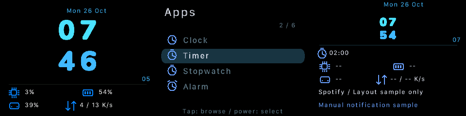

# FractureOS v3

A quiet, customizable clock for a TomTom ONE (v6), with a C device app and Go Linux hub / Windows tray companion. **v0.1.8 is an initial working release**, running on the inspected TomTom. It uses the existing OpenTom kernel and drivers; installation replaces the application startup, not the bootloader or firmware.

The original nine faces are now editable FractureOS assets. The blue Nunito face restores its original proportions with a centered date and live seconds, optional larger stacked digits, optional horizontal **HH : MM**, a blinking colon, and an hour-only behavior: **10:00 shows 10 throughout that minute; 10:01 returns to the full time** in either layout. The clock geometry adapts to a dynamic status area; date and seconds are drawn at their final text size instead of shrinking a completed image. Digits have a configurable 0–2 pixel weight (default 1). The old information sidebar and its application dependencies are absent from the new renderer. Only the selected face's 170 KB digit atlas is resident.



The interface uses pure-black backgrounds, rounded menu highlights, simple metric/timer symbols and brief 180 ms selection transitions. The owner’s SF Compact font is used locally on their TomTom; public packages include an open Nunito text atlas.

## Install

On the **Linux machine connected to the TomTom** (Ubuntu and other Linux distributions, x86-64 or ARM64):

```sh
curl -fsSL https://raw.githubusercontent.com/sepisotoni/FractureOS-v3/v0.1.8/install/install.sh | sh
```

Then, with the TomTom reachable over its USB network:

```sh
~/.local/bin/fracture device install
~/.local/bin/fracture settings
```

The installer selects the host architecture, verifies the release SHA-256, installs under `~/.local`, and starts a user systemd hub when available. Otherwise it prints the `fracture serve` command. Device deployment is explicit because the TomTom must be plugged in; it includes the legacy ARM binary and works around the missing device applets. Python 3 is required on the Linux host for deployment. No compiler is required for installation.

On **64-bit Windows**, paste into PowerShell:

```powershell
irm https://raw.githubusercontent.com/sepisotoni/FractureOS-v3/v0.1.8/install/install.ps1 | iex
```

A small guided installer installs the tray app and an Installed Apps uninstaller for the current user. Connection and clock configuration are in Settings, not setup. Windows x64 and ARM64 binaries are cross-compiled; **Windows runtime/installer testing is still pending**. macOS, 32-bit PCs and direct installation from a shell on the TomTom are unsupported.

Release archives and checksums: [v0.1.8 downloads](https://github.com/sepisotoni/FractureOS-v3/releases/tag/v0.1.8). You can download and inspect the installer before running it. Checksums verify download integrity; signed release manifests are still on the roadmap.

## Connect Windows to the hub

The hub binds to localhost by default. On the Linux hub, for this setup:

```sh
fracture config set listen 192.168.101.114:47831
systemctl --user restart fracture-v3.service
fracture pair-info
```

In Windows **Settings → Hub connection**, enter `https://192.168.101.114:47831` plus the fingerprint and token displayed by `pair-info`. Keep the token private. The hub uses pinned TLS and a bearer token; the device remains at `192.168.101.115` over the trusted USB connection. Restart the hub after changing its listen address, device address or token.

For remote access use a private network/VPN to the Linux hub; no public relay or automatic tunnel setup is included. The TomTom itself has no verified Wi-Fi. It works offline as a bedside clock while powered; network features at a different location require a USB-capable host there. The legacy root Telnet transport is for the trusted device link, not an Internet-facing interface.

## Use and customize

The launcher has **Clock, Timer, Stopwatch, Alarm, Media and Settings**. Timer and Alarm offer presets and custom values. Stopwatch has start/pause/resume, a last-lap reading and reset. Tap anywhere to browse; double-tap or a short power press selects. In a number editor, tap adds, double-tap subtracts and power applies. No touchscreen coordinates are used.

Power gestures act **on release**: below 1.5s selects; 1.5–3s goes back one page; 3–4.5s returns to the clock; 4.5–7s cancels; 7s or longer requests suspend. The optional indicator is green → blue → purple, disappears in the cancel range, then shows “Release to sleep.” A double power press also returns home. Touch hold goes back one page. Settings → Power contains confirmation screens for suspend, restart and shutdown, with Cancel selected first. The owner physically verified the indicator and Back/Home; suspend/wake and reboot/shutdown have not been exercised here.

`fracture settings` opens an on-demand browser-based settings window. Windows opens it from the native tray. **Watch faces** selects a design, changes stacked/horizontal layout, blinking and hour-only behavior, and edits colors, digit rectangles, date placement, 12/24-hour format and atlas choice. Export/import face JSON is supported; a drag-and-drop widget editor is future work. The settings process exits after five idle minutes. The browser has its own resource usage.

```sh
fracture status
fracture face nunito
fracture face-set layout stacked       # or horizontal
fracture face-set hour_only 1           # 0 keeps HH:00 visible
fracture face-set weight 1              # 0 original / 1 or 2 pixels thicker
fracture face-set blink 1               # 0 keeps colon steady
fracture face-set hour_color 4be1fa
fracture face-set minute_color 43b9ff
fracture face-get
fracture theme-set accent ff9933       # edit UI palette
fracture theme-set face_colors 1       # optionally recolor the face too
fracture theme-save my-night-theme     # save and select a custom preset
fracture theme my-night-theme
fracture face-reset                     # restore this supplied design
fracture profile bedside                # minimal / desk / bedside
fracture offset 120                     # UTC+02:00; no automatic DST yet
fracture timer 1500
fracture alarm 7 30                     # silent VISUAL alarm only
fracture alarm off
fracture stopwatch toggle              # start / pause / resume
fracture stopwatch lap                 # last-lap reading
fracture stopwatch reset
fracture config set metrics_disk /     # filesystem to measure
fracture config set metrics_interface auto # or a named Linux interface
fracture config set hub_metrics true    # Linux hub, collected only in Desk mode
```

Face files and artwork are in [`assets/faces`](assets/faces). See [face format and provenance](docs/FACES.md). User overrides live outside the versioned release and survive updates. Choose `midnight` for the iOS-inspired pure-black interface. Themes edit the launcher, fallback clock and information band. Each theme can optionally recolor imported faces; otherwise those faces keep their own palettes. Settings includes color pickers and save-as for named themes.

## Spotify on your Windows PC

Enable **Settings → Windows media → Share and control Spotify**, keep the tray running, and open the Spotify desktop app. No Spotify developer account, OAuth login or client ID is used. The Go worker reads Windows media sessions and posts bounded track/artwork updates through the authenticated HTTPS hub to the TomTom. It checks every two seconds only while the player or enabled status-bar widget is visible; disabling sharing stops the worker. This is a companion bridge, not a webhook supplied by Spotify.

On the TomTom, open **Media → Spotify** for track/artist, album thumbnail, progress, previous/play-pause/next and a volume editor. Volume changes require selecting Volume, adjusting, then applying; it controls the **Windows default audio output**, including other apps. Spotify must expose the requested controls through its Windows session. Missing capabilities stay unavailable. No browser scripting, private Spotify API, account credentials or PowerShell runtime is used.

**Windows runtime acceptance is pending**: x64/ARM64 builds exist, but playback/artwork and volume must be checked on a real Windows 10 1809+ machine. Linux hub → TomTom media/artwork transport and control queue were tested with explicitly labeled fixture data. Lyrics/subtitles, YouTube and playing the audio through the TomTom speaker are not implemented. Album art currently occupies an unobscured square beside the controls.

Desk mode restores the CPU and RAM symbols and adds disk-used percentage and download/upload KiB/s. Disk defaults to `/`; traffic defaults to IPv4 default-route interfaces, avoiding double-counting container bridges. Select another mount or interface in hub settings. These readings use the optional Linux worker, which exits when Desk is not visible. The status bar expands for timers, media and a bounded transient notification message; automatic Windows notification forwarding remains future work.

## What works now

| Component | Available in v0.1.8 |
|---|---|
| TomTom | Direct framebuffer clock; nine reused faces; editable layout/colors; stacked/horizontal/hour-only modes; switch-operated menu; minimal/desk/bedside; countdown, stopwatch and silent visual daily alarm; persisted settings |
| Linux | TLS hub, CLI, settings UI, optional CPU/RAM/disk/network worker that starts only in Desk mode and exits when unused; time sync; device deployment and restoration |
| Windows | Native tray and on-demand settings/face controls; installer/uninstaller prepared and cross-compiled, pending real Windows validation |
| Installation | Prebuilt Linux x86-64/ARM64 and Windows x64/ARM64 archives; checksum verification; versioned device payloads; original startup backup; recovery to OpenTom |

This is not all 23 planned modules. Full Windows media acceptance, audio forwarding, mirroring/true monitor extension, weather/calendar, Windows metrics/activity switching, arbitrary widget composition, GPS, signed automatic updates and a general module loader remain on the [task board](TASKS.md). Core clock/menu/timer code is currently one small binary; Linux metrics and Windows media run in separate processes only when enabled and requested. Full dynamic unloading of every core feature is not implemented.

Alarms require the device to remain powered and running; no sound or suspend wakeup is implemented. Timers and stopwatch state do not survive restart. Time uses a configured UTC offset; RTC retention and automatic DST are not validated. Brightness settings are persisted; the PWM driver allows only one opener, and effective brightness writes need a dedicated measurement rather than a second concurrent probe.

## Update, restore, uninstall

Rerun the version-pinned host installer for a newer release, then `fracture device install` on Linux. The deployer verifies each uploaded file by reading it back, backs up boot/startup files privately on the host, and installs into a new device release directory. It never silently overwrites a different executable under the same version. Failed activation returns to the saved OpenTom startup. This is a manual application update system; power-loss-safe journals and signed automatic updates are future work.

```sh
fracture device restore    # restore and start the saved OpenTom environment
fracture uninstall         # remove Linux host files/service, keep settings/backups
```

On Windows use **Installed Apps → FractureOS v3 → Uninstall**. Removing a host app does not uninstall the TomTom. Restore the device first if that is desired. Device rollback files and original face directories are preserved; no old project files or firmware images are published here.

## Build, test and development

- [Task board](TASKS.md) — completed deliverables and outstanding modules.
- [Release validation](docs/RELEASE-VALIDATION.md) — measured results and testing limits.
- [Platform diagnostics](docs/DEVICE-VALIDATION.md) — hardware, ABI and missing applets.
- [Current implementation](docs/IMPLEMENTATION.md) — release architecture and deviations from the design.
- [Product vision](docs/PRODUCT-VISION.md), [architecture design](docs/ARCHITECTURE.md), [module specifications](docs/MODULES.md) — long-term scope, not claims of completed features.

Host code uses only the Go standard library. Release builds use the verified toolchain recorded in [`docs/HOST-TOOLCHAIN.json`](docs/HOST-TOOLCHAIN.json), obtained from the [official Go downloads feed](https://go.dev/dl/?mode=json). Device builds require the compatible GCC 3.3.4/glibc 2.3.2 OpenTom SDK; modern ARM EABI binaries do not run on this device. Set `FRACTURE_SDK` to its directory. Toolchain provenance is recorded; the legacy SDK is not bundled.

```sh
sh tools/build-device.sh
go test ./host
python3 tools/package-release.py
```
