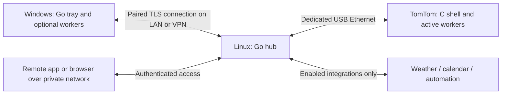

# FractureOS v3 architecture

Design version 1, 2026-10-26. This document settles the implementation direction. Hardware-dependent claims remain explicit gates in `../TASKS.md`; none are reported as tested v3 behavior.

## 1. Foundation and physical topology

Build new FractureOS application code in C on the TomTom and Go on Windows/Linux. Retain the working OpenTom kernel, bootloader and hardware drivers. Building a replacement kernel is outside v3's application scope; prior prototype application code is not reused. The device shell draws directly to the framebuffer; Nano-X and its application supervisor must relinquish display/input ownership during v3 operation. A boot wrapper selects exactly one environment and preserves recovery access.

Verified in earlier read-only inspection: ONE (v6), ARM926EJ-S/ARMv5TEJ, Linux 2.6.13-LeddaZ, 30,016 KiB reported RAM, no swap, RGB565 320×240 visible framebuffer with 320×480 virtual geometry, approximately 489 MiB mounted FAT storage with 439 MiB free at inspection. Exact CPU frequency, binary ABI, usable audio, battery health, brightness control and wake-from-suspend alarms are unverified. Existing device-node names alone prove none of those capabilities.

Treat the user's damaged touchscreen as a single switch: coordinates are ignored by default everywhere. Optional coordinate mode is a future setting only after explicit validation. A connected evdev touchscreen does not establish reliable physical input. No Wi-Fi or wireless networking has been verified.

Default deployment follows the user's physical arrangement: TomTom always attached to Linux; Windows communicates with the hub. Linux currently owns `.114`, and the TomTom owns `.115`. Preserve this configuration unless a separately planned network change is needed. The host also has a LAN route overlapping the USB subnet; bind device connections to the USB path and preserve the existing host route. These addresses are configurable settings, never identity or authorization.

Standalone bedside/travel mode runs entirely on-device with external USB power or the battery if usable. A wall charger supplies no network. Moving the device to another room or location does not create wireless connectivity: online use there needs a USB-capable Linux host/bridge and a network connection. VPN runs on that host, not the legacy TomTom. Direct Windows USB operation is secondary and gated on compatible USB Ethernet drivers. Remote access from elsewhere can also mean controlling the original hub-attached device without moving it.

## 2. Executables and lazy lifetime

| Component | Language | Resident responsibilities |
|---|---|---|
| `fracture-supervisor` | C | Start shell, reap workers, select healthy release, recover after crash |
| `fracture-shell` | C | Active face, input, local clock, next scheduled deadline, settings snapshot, capability/lease registry |
| `fracture-link` | C | USB connection and bounded state exchange; only when connected mode enabled |
| Device workers | C | Separate executables for GPS, audio, streamed display and optional app screens |
| `fracture-hub` | Go | Pairing, routing, configuration ownership, leases and worker supervision |
| `fracture-tray` | Go | Native Windows notification icon, hub link, lifecycle supervision |
| `fracture-studio` | Go | Native Windows Settings and face editor; separate process existing only while open |
| Host workers | Go | Metrics, activity, integrations, media and capture; separate executables per integration boundary |
| Updater helpers | C / Go | Spawn only during install/activation/recovery |

Use processes rather than Go runtime plugins. [Go plugins cannot unload and are unsupported on Windows](https://go.dev/pkg/plugin/?m=old). A disabled optional worker has no live process, executable mapping, polling, network session or active data cache. OS filesystem caches may still contain previously accessed executable pages; do not describe that as zero system RAM consumption. Small shared primitives such as text drawing, input and clock scheduling remain in the core.

State machine: `disabled → available → starting → running → stopping → available`; faults enter `failed`. Enabled means available, not running. A module starts only with a lease from a visible widget, open app, explicit streaming session or enabled background rule. Multiple consumers share one worker; the fastest permitted requested cadence wins. Losing the last lease stops the worker immediately, with a two-second orderly shutdown limit then forced termination. Explicit disabling revokes leases, rejects new ones and clears sensitive cached state. Process exit reclaims worker memory reliably.

Start a new worker only after its dependency permissions and resource estimate pass. Do not start all dependencies at boot. Crash retry: 1, 5 and 30 seconds; after three failures in five minutes, show unavailable until explicit retry or next session. Release device handles on exit. Exclusive leases arbitrate display and audio; alarms preempt optional streaming. Alarm deadlines are maintained by the small core scheduler, so closing an alarm editor does not disable a scheduled alarm. A configured recurring alert/history rule is an explicit background consumer and is shown as such in Settings.

Module manifests contain stable `id`, module/API version, executable, platform, required capabilities, declared topic inputs/outputs, settings schema version, memory estimate and permissions. The core reads small manifests for menu labels; it never executes modules merely to enumerate them. Do not accept downloaded executable face packs. New native modules ship through signed releases; declarative face packs can be imported separately.

## 3. Rendering and input

The shell is the only framebuffer writer. Read actual mode, pitch, channel layout and offsets with framebuffer ioctls; never assume virtual height permits safe page flipping. Start with one 153,600-byte RGB565 software frame and dirty-region copies. An optional second buffer costs the same. Clock with no seconds redraws once per minute and on events. Animations are off in minimal/bedside mode; active transitions cap at 10 fps initially. Recompute only changed widgets.

Use bitmap fonts and preconverted RGB565 assets generated by the host; runtime image/HTML engines are unnecessary. Host previews use the same C renderer through a preview helper; approximate UI previews must be labeled until renderer parity exists. A scene has at most 64 widgets and a 2 MiB decoded asset budget. If unavailable data is stale, render age/unavailable state rather than a believable zero. Optional app workers send bounded scene commands to the shell, never direct framebuffer writes.

Default gestures: short power press opens the launcher from the face; in the launcher it selects the highlighted item. Tap anywhere advances selection; double tap selects; touch hold goes back. Double power press returns home; long power press opens the power/brightness menu, not immediate suspend. Defaults: debounce 60 ms, double window 320 ms, touch hold 700 ms, power long 900 ms. Delay single dispatch until the double window expires, emit long once, and suppress its later short event. A held/noisy touch never repeats a PC action. Timeouts reset the gesture state. A scan-selection option lets one tap choose an automatically highlighted item if release/hold is unreliable.

The old power daemon reportedly suspends at 400 ms. It must stop owning the button before v3 mappings are enabled. Inspect kernel-enforced hold/reset behavior first; do not promise software can override it. Core power actions remain accessible if an optional module crashes. Show a focus ring and action label at all times in menus. User configuration can change timing and mappings, but a recovery/home path remains reachable without coordinates.

## 4. Clock, profiles and persistence

Clock has `valid`, `unsynchronized` and `invalid` states. Read RTC at boot when supported, and accept authenticated host time updates. A retained valid RTC permits offline operation; if lost, show a time-setting prompt in the local menu rather than silently displaying epoch time. Countdown/stopwatch durations use monotonic time; wall-clock corrections do not extend them. Record configured alarms and timer deadlines on meaningful changes, not every second. After reboot, recompute from a trustworthy wall clock or clearly mark interrupted timers.

Hub/Studio converts IANA timezone data to a device table of UTC transitions covering the next two years. Device handles local schedules and repeat alarms using that table; show a refresh-needed status at expiry, retain last offset and offer manual UTC offset. DST fallback fires each alarm once per local date; spring-forward missing times fire at the next valid instant. Large clock jumps flag missed alarms; only alarms missed within five minutes trigger automatically, others become a missed reminder. Quiet alarm is visual by default; enabling sound is an explicit setting with a preview. Wake from power-off/suspend is not supported until demonstrated; bedside alarm mode keeps the scheduler awake with dimmed display.

Profile precedence: manual override, active alarm interaction, scheduled profile, configured PC activity rule, saved default. Guest privacy filtering applies regardless of profile precedence. Manual override defaults to lasting until changed; timed overrides are optional. Active alarms temporarily overlay faces then restore prior state. PC disconnect becomes idle after 30 seconds; activity changes use a five-second hysteresis to avoid flapping. Default PC idle threshold is five minutes and configurable; presence collection is separately enabled from resource monitoring.

Store only settings, scenes, schedules and compact checkpoints on the TomTom. Use alternating checksummed records with increasing generations; choose the highest valid record after interrupted writes. Persist changes on commit and flush before acknowledging persistence. Keep one previous settings snapshot for rollback. FAT rename/sync is not a guarantee against power-loss filesystem corruption; recovery must also work from host backup. Logs default to bounded RAM; historical graphs are optional hub storage, not continuous SD writes.

## 5. Interfaces and data flow

Local worker IPC: inherited pipes, four-byte big-endian length followed by UTF-8 JSON; 64 KiB limit per message. No child shell execution or arbitrary command text. Messages contain protocol version, request ID, type and body. Basic verbs: `hello`, `start`, `subscribe`, `data`, `invoke`, `result`, `stop`, `health`. Binary streaming uses a separate bounded channel; control parsing cannot be blocked behind frames. All worker stdin/stdout plumbing is private; stderr goes to bounded logs.

Windows ↔ hub: TLS 1.3 WebSocket control endpoint on configurable port 47831, explicit peer pairing with pinned certificate and per-peer bearer credential stored in Windows Credential Manager / a restricted host file. The browser settings endpoint uses an authenticated session and CSRF protection; no credentials in URLs. Default bind is loopback; enabling LAN/private-network access is a Settings action. No cloud relay is required. Pairing is a connection/security step in Settings, not an installer questionnaire.

USB device link: new framed TCP protocol on configurable port 47832, bound to USB interface. Hub initiates and device accepts only its paired hub. Provision a random device key through the trusted local installation channel. Use a reviewed HMAC-SHA256 implementation, per-connection unpredictable nonces, directional keys and monotonic sequence numbers; authenticate every bounded frame before parsing. CSPRNG availability must pass P001/P003; fail closed if unavailable. This authenticates USB traffic but does not encrypt it. The USB endpoint is never routed onto LAN/public internet; remote traffic terminates TLS/VPN at the modern host, then traverses the physical USB link. Sending private data over USB is an explicit trust assumption shown in settings documentation.

Shared control types: `hello/capabilities`, `subscribe/unsubscribe`, `snapshot/delta`, `config.propose/commit`, `action.invoke/result`, `time.sync`, `health`, `update.stage/activate`. Major protocol mismatch blocks mutation; capability negotiation hides unsupported features. Example topic names: `clock`, `host/<id>/metrics`, `host/<id>/presence`, `weather/current`, `calendar/next`, `media/current`, `device/power`. Samples carry source ID, value/unit, observed time, validity and TTL. Hub tracks receipt time too; device expiry uses monotonic elapsed time. No zero-valued substitution for missing samples.

Subscriptions have lease IDs, requested interval and expiration (30-second renewal, 90-second expiry). Core heartbeat is 30 seconds when idle; reconnect backs off 1→2→4→8→30 seconds with jitter. Control queue maximum 64 messages; latest-value telemetry replaces older values rather than growing a backlog. Actions are never queued while offline. Use session IDs, request IDs, short expiries and deduplication to prevent repeat mutations. After uncertain execution, show unknown and require status reconciliation; do not blindly retry power, automation or playback commands.

Face source format: versioned JSON with canvas dimensions, palette/fonts, asset references, widget IDs/types/rectangles/z-order, data bindings, refresh limits, visibility and named actions. Actions reference registered commands, never embedded scripts. Studio compiles bounded device bundles; reject oversize or out-of-bounds scenes before deployment. Keep editable JSON and source assets on the hub/PC. Device handles a fixed validated subset. User-authored arbitrary logic belongs in a permissioned host worker.

Configuration owner is the hub in the normal topology; local-only settings on the device remain editable offline. Each transaction has schema version, scope and expected revision. Conflicts return current revision for review, never silently overwrite an offline edit. Device-only essentials include time/offset, profile, brightness, alarm/snooze, timer presets and connection status. Advanced editing stays in Studio or hub settings. Secrets never enter exported face/profile bundles. Single pairing authority per device; direct Windows mode transfers that role explicitly.

## 6. Settings and editor

Use native Windows tray APIs from Go and a separate Go/Win32 settings/editor process; no persistent browser runtime. Categories: Device, Faces, Profiles, Input, Time & Alarms, Modules, Windows Data, Hub & Remote, Integrations, Feedback, Updates, Diagnostics. The editor has a 320×240 canvas with drag/resize, numeric geometry, alignment/snap, layers, style, data/action selectors, preview and apply/undo. Each property persists in the face schema. Closing it terminates its process and releases previews/subscriptions.

Optional hub UI uses Go's HTTP server with bundled HTML/CSS/JS, served only when enabled, for phone/Linux/remote settings access. It uses the same validation and revision APIs as Studio. This browser UI is an optional client of the Go service, not a replacement for the requested Windows app. It loads only in an open browser. No account or cloud subscription is required for local clock features.

## 7. Updates, deployment and budgets

Build package paths: `device/` C core/workers, `host/` Go services/workers, `studio/` Windows UI, `protocol/` schemas and fixtures, `faces/` templates, `tools/` asset/build helpers, `docs/`. Reproducible compiler/sysroot pinning is required; ABI/OABI/EABI, loader and supported syscalls must be established on the actual target. A modern ARMv5 binary or statically linked modern libc may still require a newer kernel. Do not replace the running kernel to mask a toolchain mismatch.

Device packages install into two application slots below a new v3 directory. Signed manifests specify architecture/ABI, protocol range, version, file sizes and SHA-256 hashes. Updater verifies signature with a pinned public key and verifies every staged file; rejects path traversal, symlinks, wrong ABI, insufficient space and incompatible config. Signing key lives outside the repo. Stage inactive slot, flush, journal pending generation, start candidate, require 30 seconds of shell/input/render health, then mark healthy. Three failed starts roll back to the previous slot and settings snapshot. No automatic rollback of recorded alarm occurrences. Routine releases never update kernel, bootloader or partition layout. Host updater preserves a previous release and uses an external helper so it can replace its own executable on Windows.

First deployment requires backup, a live recoverable shell and a bounded reversible display trial. Do not use the previous prototype's STOP/CONT scripts as the new supervisor. Activation must stop the old autostart loop as well as its display/input applications, otherwise it will respawn competitors. The installer records exact changes and a tested OpenTom restore entry.

Initial engineering targets (not measured promises): device supervisor+shell ≤4 MiB RSS in minimal clock, all v3 processes ≤10 MiB in normal mode, preserve ≥6 MiB free/reclaimable headroom; Windows idle tray ≤30 MiB private memory and hub ≤40 MiB RSS excluding enabled workers. Target <1% host idle CPU over 60 seconds, <3% device minimal-clock CPU and ≤1 KiB/s steady minimal-clock traffic after sync. Count aggregate worker memory, not only parent. Editor/streaming have separate recorded peaks. Start denied or optional stream stopped when budgets/headroom fail; retain input, clock and alarms. Use actual measurements to revise budgets explicitly, never conceal overages.

## 8. Validation boundaries

Native simulator exercises the same renderer, scene parser, gesture machine, time and scheduler core as device code. C/Go golden protocol fixtures cover truncation, length limits, bad authentication, old sequence numbers, wrong versions and partial reads. Lifecycle tests assert no workers/collectors after disabling or closing the last consumer, including dependency sharing and crashes. Run on-device framebuffer/input and repeated start/stop trials after platform proof.

Windows runtime checks require a real logged-in Windows session: tray recreation after Explorer restart, WinRT media, lock/idle, capture and WDK driver behavior cannot be certified by Linux cross-builds. Audio, GPS lock, suspend wake and display streaming remain unsupported until hardware evidence is recorded. A finished module means behavior demonstrated, unloading measured, disconnect/error paths handled and task evidence recorded.
