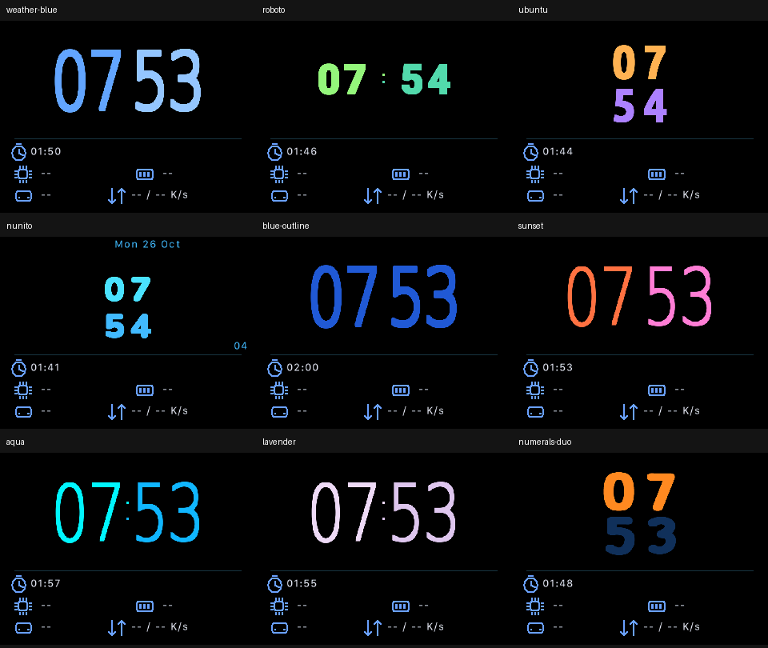
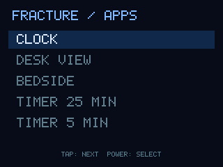

# Editable legacy faces

The owner requested reuse of the existing face artwork while replacing the previous application. Nine preset clock designs are included: Blue Outline, Aqua, Lavender, Sunset, Weather Blue, Numerals Duo, Roboto, Ubuntu and Nunito. Weather Blue preserves the clock palette only; no weather provider or sidebar is part of this port. Aqua is a static palette in this release, without wave animation.

The six original 1000×170 grayscale digit atlases were copied from the owner's `tomtom-opentom-research/watchface-research/preview` project. Their SHA-256 values are in `assets/faces/provenance.json`. SVG artwork and the original font/numeral generation scripts are retained in `assets/faces/sources`; the generators are development tools, not device runtime dependencies. Generator output should be placed alongside the other atlas files after review, not automatically copied over a running installation.

Font notices for DejaVu, Roboto, Ubuntu and Nunito are supplied in `assets/faces/licenses`. Custom Numerals Duo artwork comes from the previous owner-directed face project. These assets are not TomTom stock map/firmware assets. Font names identify their typefaces, not ownership by FractureOS. No previous sidebar, animation/weather server, calendar, map logo, Nano-X UI or live-watchface code is linked into the new device executable.

## Format

A `.face` file is a bounded key=value document referencing one PGM atlas in the same asset directory. PGM format is deliberately fixed: `P5\n1000 170\n255\n` followed by exactly 170,000 bytes. Cells 0–9 are 100×170; each pixel is alpha coverage. Files are data, never executable plugins. One selected atlas is allocated; switching replaces it (a second buffer exists briefly while validating a replacement).

| Field | Values |
|---|---|
| `atlas` | Safe filename, no directory traversal |
| `hour_color`, `minute_color`, `background` | Six hexadecimal RGB digits, without `#` |
| `layout` | `stacked`, `horizontal`, `custom`; choosing a named layout supplies digit and colon rectangles |
| `digit0` … `digit3` | `x,y,width,height`, wholly inside 320×240; hours then minutes |
| `time_format` | `12` or `24` |
| `hour_only` | `1`: during minute 00 show two centered large hour digits; at minute 01 restore the full selected layout |
| `colon`, `blink` | 0/1; blink changes the colon once per second, hidden for hour-only display |
| `colon_x`, `colon_y`, `colon_gap`, `colon_size` | Position, vertical spacing and square size |
| `show_date`, `show_ampm`, `show_seconds` | 0/1 |
| `weight` | 0–2 pixel digit expansion; omitted defaults to 1 |
| `date_x`, `date_y`, `date_scale` | Position and integer bitmap text scale 1–4 |

Named layout changes intentionally replace the digit positions; later individual rectangle edits customize those positions. Supplied files serialize layout before digit rectangles so saved positions take precedence. `face-reset` removes the current user override and reloads the supplied design. Editing a field validates it before an atomic save; the UI applies changed fields individually, not as one multi-field transaction.

Release assets live in `/mnt/sdcard/fracture-v3/releases/vVERSION/faces`. User overrides live in `/mnt/sdcard/fracture-v3/faces`; selection is in `settings.cfg`. Missing/invalid artwork falls back to the built-in text clock. Atlas failure during selection preserves the previous working face.

Host Settings supports face selection, explicit layout/behavior controls, field editing and JSON import/export. The JSON contains settings, not embedded bitmap files. New artwork is currently a developer packaging task; uploading arbitrary assets and drag-and-drop widget editing are future work.

## Extra information and themes

The dynamic status bar adds rows for active timers/stopwatch/alarm, two rows of icon-based hub metrics, media and a transient notification. Digit rectangles are projected directly into the remaining clock area at their original aspect ratio. Date and seconds are rendered afterward at a readable text size, never post-scaled with the framebuffer. Compact clocks reserve space above the digits for the date. No second framebuffer is allocated.

UI themes are independent `.theme` data files in `assets/themes`. Each contains `background`, `foreground`, `muted`, `accent`, `surface`, `hour_color`, `minute_color` (six RGB hex digits each), plus `face_colors=0` or `1`. By default faces retain their own palettes; enabling `face_colors` applies theme background/hour/minute colors to them too. Bedside mode dims selected colors.

`theme-set KEY VALUE` edits the selected preset override; `theme-save NAME` saves the current palette as a new named preset and selects it. `theme NAME` selects it later. `theme-get` exports the current palette as JSON. `theme-reset` restores a supplied preset; custom names without a supplied base cannot reset. Theme user files live alongside face overrides under `/mnt/sdcard/fracture-v3/themes` and survive application updates. There is no theme worker or unselected-theme allocation.

## Current Nunito presentation

The owner selected the original 55×88 digit rectangles at x=101/164 and y=42/130, with the date centered above them and seconds at the lower right. `show_seconds=1` updates once per second; set it to 0 for minute-only redraws when nothing else needs updates. Large stacked and horizontal layouts remain selectable. The pure-black `midnight` theme supplies rounded menus and symbols without recoloring the face by default.

Menu selection eases over 180 ms at the existing 50 ms input polling cadence, then stops. It does not keep an animation worker or continuous frame loop alive. UI text uses a 45.7 KB pre-rasterized atlas, so no font engine runs on the TomTom. The owner’s private SF Compact atlas remains outside repository/release assets; `assets/ui/default.bin` provides the distributable Nunito fallback.
